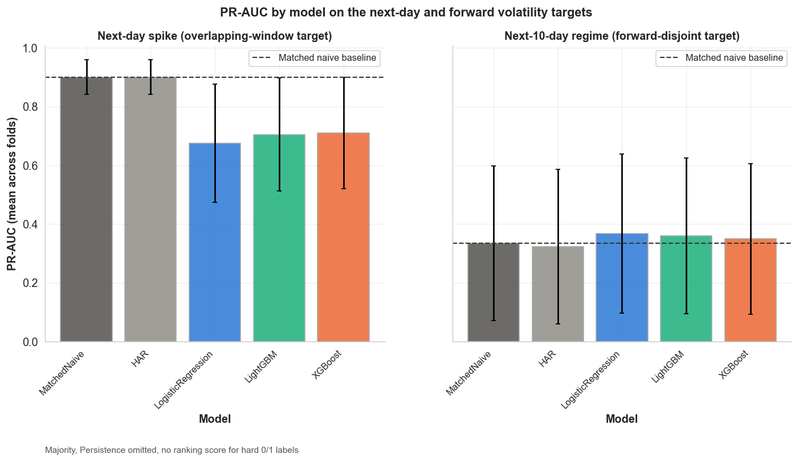

# Forecasting Volatility Regimes in US Equities

A leakage-aware time-series machine learning pipeline for forecasting whether each of 14 U.S. equities will be in a high-volatility regime over the next 10 trading days.

The analysis uses 37,002 observations from 2015 to 2026 and compares logistic regression, LightGBM, XGBoost, and a HAR-style benchmark against matched naive baselines under expanding-window validation with horizon-exact purging.

An initial next-day volatility target produced high scores because its feature and label windows overlapped by nine days. Reframing the task around a forward-disjoint 10-day target removed that shortcut and produced a more defensible estimate of out-of-sample forecasting skill. On this target, logistic regression reached 0.368 average precision versus 0.334 for the matched naive baseline, a +0.034 absolute lift that stayed significant under two dependence-aware bootstraps after a Holm correction across the three learned models.

> This is a research and educational forecasting study, not a production trading system or investment strategy.



## Separating persistence from predictive skill

The analysis compares two labels built from the same historical per-ticker volatility threshold.

- **`NextVolSpike`** is a negative control. It asks whether tomorrow's 10-day rolling volatility exceeds the threshold, but its label window overlaps the current feature window by nine of ten days. The matched naive rule and HAR both reach average precision near 0.90 and outperform every learned model. Both use the per-ticker threshold the labels are built on, which the learned models do not receive, so this ordering does not show persistence beating them.
- **`FwdVolRegime`** is the primary target. It asks whether volatility over the next 10 trading days exceeds the threshold. Its label window is disjoint from the current feature window, so performance reflects forward ranking skill rather than a near-restatement of today's regime.

The matched naive baseline flags a regime whenever current volatility already exceeds the same stored threshold used by the labels. It captures the persistence a learned model must beat. The learned models do not receive that per-ticker threshold as a feature.

## Results

Forward target, mean across 28 expanding-window folds:

| Model | Precision | Recall | F1 | Average precision |
|---|---:|---:|---:|---:|
| Majority | 0.0000 | 0.0000 | 0.0000 | n/a |
| Persistence | 0.3324 | 0.3271 | 0.3238 | n/a |
| HAR | 0.2956 | 0.2563 | 0.2644 | 0.3226 |
| Matched naive | 0.3157 | 0.3213 | 0.3155 | 0.3342 |
| XGBoost | 0.3276 | 0.4400 | 0.3620 | 0.3499 |
| LightGBM | 0.3300 | 0.5017 | 0.3805 | 0.3604 |
| **Logistic regression** | **0.3164** | **0.5450** | **0.3849** | **0.3677** |

The logistic-regression improvement is **0.0335 average-precision points**. Two dependence-aware bootstraps test it, and neither is designated primary. A fold-block bootstrap resamples blocks of four consecutive folds and gives a 95% interval of **[0.0136, 0.0605]**, with **p=0.0022** and **Holm-adjusted p=0.0066**. A date-block bootstrap resamples 21-trading-day blocks of dates, each carrying its full cross-section of equities, recomputes each fold's average precision on the dates drawn, and gives **[0.0093, 0.0475]**, with **p=0.0087** and **Holm-adjusted p=0.026**. Holm adjusts across logistic regression, LightGBM, and XGBoost. Only the fold-block test resamples across market periods, since the date-block test keeps the 28 test windows fixed.

The result is small but holds under both tests. Logistic regression is the only learned model whose lift remains significant under both after Holm correction. LightGBM's unadjusted p-values are 0.0358 (fold-block) and 0.0400 (date-block), close enough to 0.05 that they may change with the bootstrap settings, and neither Holm-adjusted p-value is below 0.05. XGBoost is not significant under either test. HAR scores below the matched naive rule (fold-block p=0.0395, date-block p=0.1053), but it ranks days by an absolute margin over the threshold rather than the naive rule's ratio, so that comparison is not like-for-like. Precision, recall, and F1 use each model's own decision rule: a score above 0.5 for the learned models and HAR, current volatility above the stored threshold for the matched naive rule, and a pooled training-fold threshold for persistence. Average precision is therefore the comparable metric.

## Leakage and shortcut controls

Three safeguards keep future information out of training, and one removes a shortcut:

1. **Past-only thresholds.** The per-ticker 80th-percentile threshold is computed with `shift(1)`, excluding the present and future.
2. **Disjoint windows.** The primary label measures volatility over `t+1` through `t+10`, separate from the current 10-day rolling-volatility feature window. This removes a shortcut rather than a leak: it drops the correlation between current volatility and the labeled quantity from about 0.96 for the next-day target to about 0.47 for the forward one.
3. **Horizon-exact purging.** Any training row whose label window reaches the test period is removed before fitting.
4. **Train-only scaling.** The logistic-regression scaler is fit separately inside each training fold.

[`tests/test_split.py`](tests/test_split.py) asserts temporal ordering, zero train-test overlap, purge boundaries, incomplete-label handling, minimum training size, and final-fold behavior.

## Robustness and interpretation

A sensitivity grid recomputes the target across 70th, 80th, and 90th percentile thresholds and 5-, 10-, and 21-trading-day horizons. Under the fold-block test, without adjustment across the nine cells, the lift is significant at every tested threshold for the 5-day horizon and at the 70th and 80th percentiles for the 10-day horizon. At 21 days every interval includes zero, so the grid neither establishes nor rules out an edge at that horizon. Each cell also rebuilds the threshold and the naive baseline from that horizon's trailing volatility while logistic regression keeps its features, including the 10-day `RollingVol`, and the number of scored folds varies from 26 to 29, the 29th at 5 days being a short final window.

At a pooled 20% alert budget, logistic regression reaches 0.6226 precision and 0.4651 recall, compared with 0.5285 precision and 0.3948 recall for the matched naive baseline. The pooled cutoff is one score quantile over all 28 quarters together, so it depends on later data, which makes these retrospective tradeoffs rather than a production alert policy.

Logistic regression, the saved model's specification, is interpreted through standardized coefficients refit in each walk-forward training window, while a separate XGBoost model, trained through 2022, is explained with SHAP on the 2023-onward rows, which that XGBoost model never trained on. They are not untouched, though: the walk-forward comparison that chose the final model includes them. VIX and current rolling volatility emerge as positive signals in both views. Their logistic-regression signs hold in every fold, though the folds' nested training windows make that weaker evidence of stability than independent samples would give. Raw class-weighted scores are not treated as calibrated probabilities.

Full significance, sensitivity, operating-point, explainability, and calibration results are in [`docs/METHODOLOGY.md`](docs/METHODOLOGY.md).

## Reproducing the analysis

Requires [uv](https://docs.astral.sh/uv/), which installs Python 3.12 and the locked dependencies. On macOS, LightGBM and XGBoost also need the OpenMP runtime (`brew install libomp`).

```bash
git clone https://github.com/tisyasharma/volatility-regime-forecasting.git
cd volatility-regime-forecasting

make install
make test
make results
make sensitivity_grid
make model
```

`make results` runs evaluation, significance testing, operating-point analysis, and metrics-derived figure generation. The shared `src/` modules contain the reusable analysis logic, and the notebooks provide an interactive path through data collection, EDA, modeling, explainability, and calibration.

**What reproduces exactly.** `make test` regenerates the committed metrics, the out-of-fold predictions and the saved model in a scratch copy. It requires the metrics and the model's metadata to match exactly, and the out-of-fold and model scores to match within small per-model tolerances. That has been verified on macOS on Apple silicon only. LightGBM and XGBoost scores differ on x86 even for identical inputs, and so do seven of the thresholds `make verify_vol_threshold` derives, in the last bit. On other machines, run `uv run pytest -m "not golden and not network"` to skip the tests that require exact reproduction. `make results`, `make sensitivity_grid` and `make model` overwrite the committed files in `reports/metrics/`, `reports/figures/` and `models/artifacts/`. On another platform, `git diff` shows the drift and `git checkout -- reports/metrics reports/figures models/artifacts` restores them. Notebook 00 re-downloads prices through the current date, so its datasets differ from the committed ones. Run from the repository root or from `notebooks/`, it overwrites `data/`, which `git checkout -- data` restores.

## Data and scope

The processed dataset contains 37,002 rows for 14 U.S. large-cap equities in six industry groups, covering 2015-07-20 through 2026-01-21. Daily OHLCV data and VIX were collected through `yfinance`, and all nine model features are available by the end of trading day `t`. The VIX feature is the index's daily close, and Cboe disseminates VIX values until 4:15 p.m. ET, after the 4:00 p.m. ET equity close ([Cboe Volatility Index Methodology](https://cdn.cboe.com/resources/indices/Volatility_Index_Methodology_Cboe_Volatility_Index.pdf), section 4).

See the [`dataset card`](reports/dataset_card.md) for exact tickers, feature definitions, label construction, representation gaps, and data-use constraints. The MIT license applies to the source code, not to the underlying market data or provider terms.

## Limitations

- **Modest effect size.** Logistic regression improves average precision by 0.0335 over the matched naive baseline.
- **Selection on the reported quarters.** Logistic regression was chosen as the learned model with the highest mean average precision on the same 28 quarters that report its edge. The Holm correction accounts for testing three candidates, but the chosen model's edge is likely optimistic, and no untouched period has been evaluated.
- **Bootstrap settings.** Both bootstraps use block lengths set in the code (4 folds and 21 trading days) rather than estimated from the data, and their blocks do not wrap around, so the folds and dates within one block length of either end are drawn less often than the rest. Results near 0.05, such as LightGBM's unadjusted p-values, may change with these settings.
- **Equal weighting.** The headline average precision is an equal-weighted mean over 28 quarters whose positive rates range from 4.2% to 69.7%.
- **Concentration.** Logistic regression's AP is above the naive rule's in 19 of the 28 quarters, and the five largest per-quarter differences in `walkforward_per_fold.csv` sum to about 62% of the total.
- **Limited breadth.** The universe contains 14 equities in six industry groups, including correlated names.
- **Horizon dependence.** In the sensitivity grid's fold-block test, unadjusted across its nine cells, the edge is significant at every tested threshold for the 5-day horizon and at the 70th and 80th percentiles for 10 days. At 21 days the intervals include zero, which neither shows nor rules out an edge.
- **No trading backtest.** Transaction costs, execution, portfolio construction, and risk-adjusted returns are outside the project scope.
- **Calibration drift.** Raw class-weighted scores require new out-of-sample calibration before probability-based use.

## Documentation

- [`docs/METHODOLOGY.md`](docs/METHODOLOGY.md): complete analytical and statistical methodology
- [`reports/model_card.md`](reports/model_card.md): model behavior, intended use, evaluation, and risks
- [`reports/dataset_card.md`](reports/dataset_card.md): provenance, structure, labels, and data-use guidance
