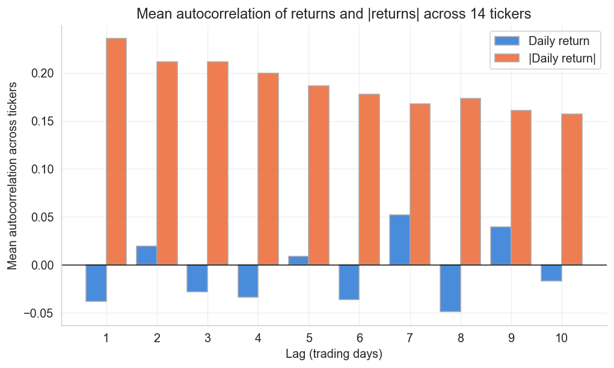
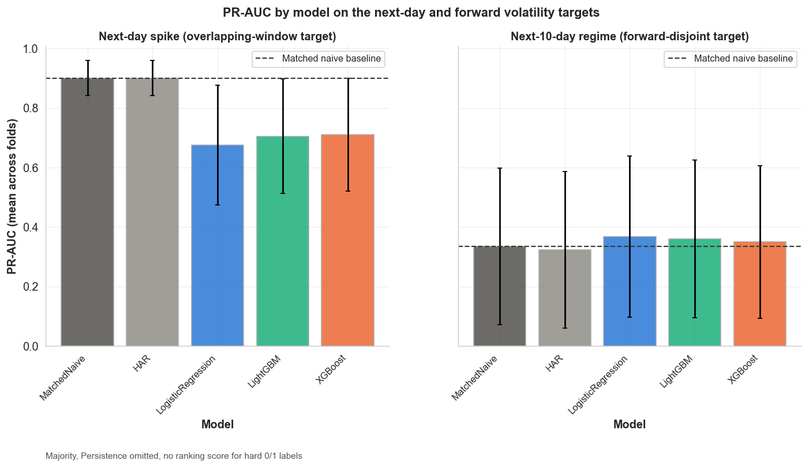
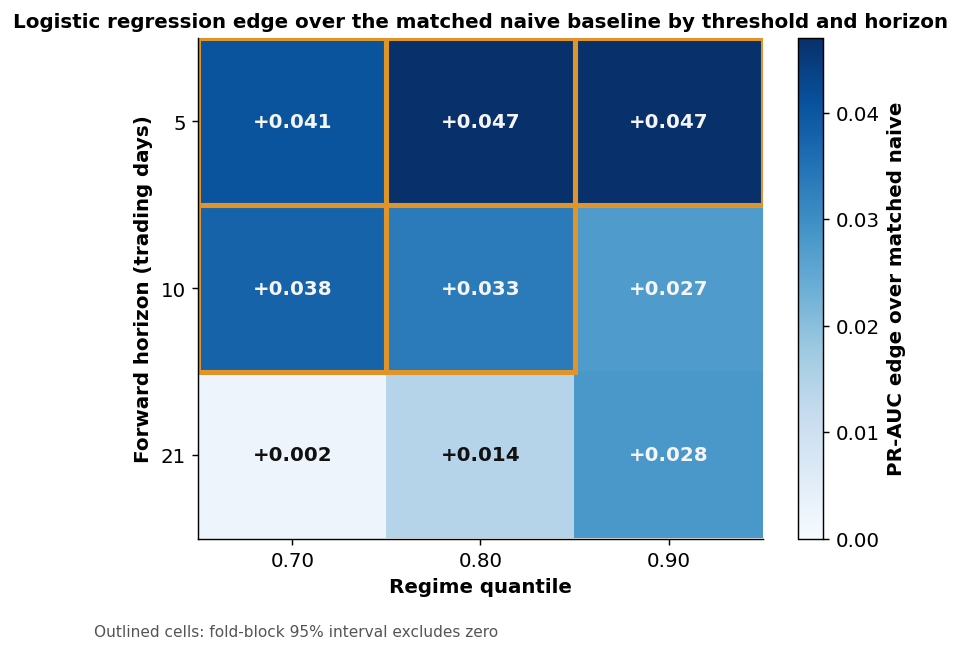
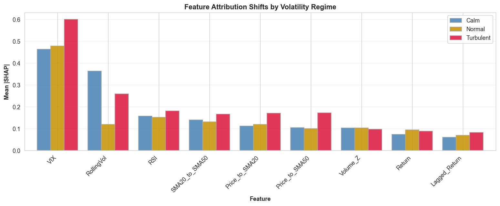
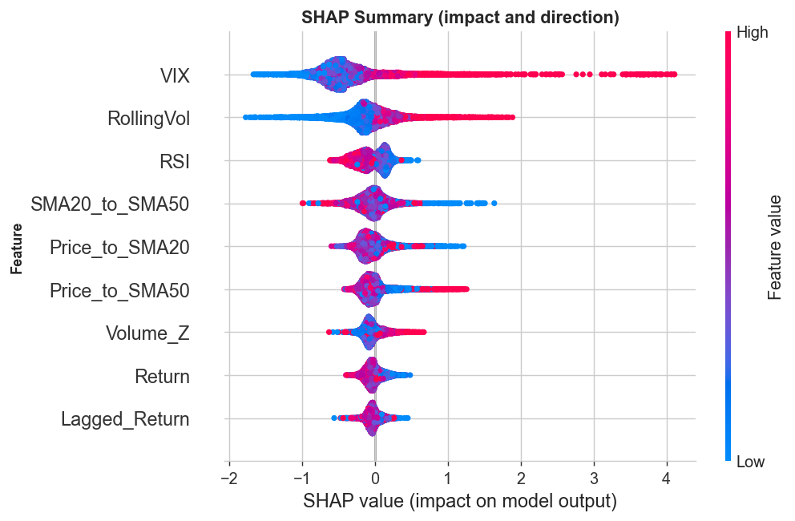
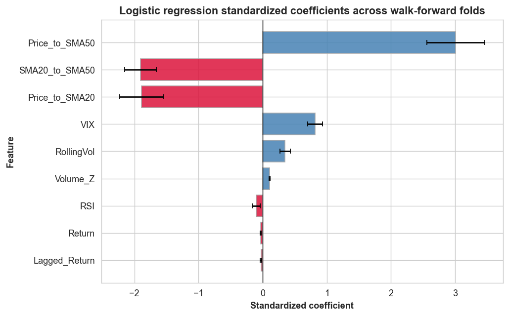
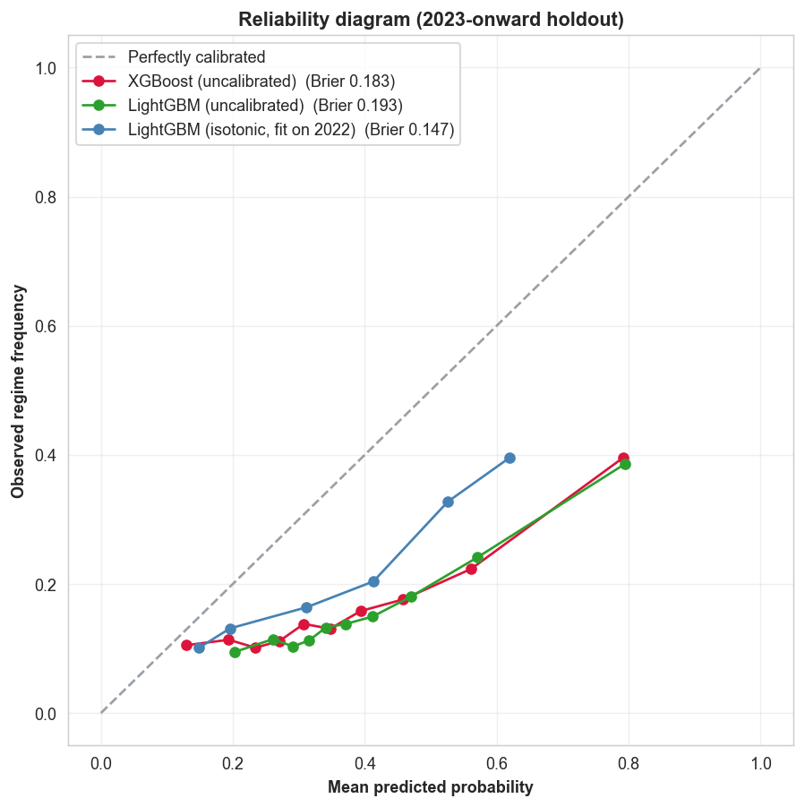

# Methodology and Results

This document provides the complete analytical rationale, validation design, results, and limitations behind the [project README](../README.md).

The study asks whether information available by the end of trading day `t` can rank which equity-days will be in a high-volatility regime over the next 10 trading days, once overlapping windows, naive persistence, temporal dependence, and cross-sectional co-movement are handled explicitly.

## 1. Study motivation

The initial exploratory analysis considered next-day return direction. Across the 14 equities, the direction label is positive on 52.8% of observations, reflecting a persistent upward drift, while raw daily returns show little serial dependence that would support a useful conditional forecast.

Volatility behaves differently. Absolute daily returns have positive short-lag autocorrelation, around 0.24 at a one-day lag and slow to decay, consistent with volatility clustering (Cont, 2001). That persistence motivates a volatility target, but it also creates the main methodological risk: a model can appear predictive when the target largely repeats information already present in the feature window.



The project therefore treats target construction and baseline selection as part of the forecasting problem rather than as preprocessing details.

## 2. Data and features

The processed dataset contains **37,002 model-ready equity-day observations** from **2015-07-20 through 2026-01-21** across 14 U.S. equities:

- technology: AAPL, MSFT, AMZN, GOOGL, NVDA, TSLA;
- finance: JPM;
- retail: WMT;
- airlines: DAL, UAL;
- defense: LMT, RTX, NOC;
- energy: XOM.

Daily OHLCV data and VIX were collected through `yfinance`. Nine features are used, all known by the end of trading day `t`:

1. `Return`
2. `RollingVol`
3. `RSI`
4. `Price_to_SMA20`
5. `Price_to_SMA50`
6. `SMA20_to_SMA50`
7. `Volume_Z`
8. `VIX`
9. `Lagged_Return`

The `VIX` feature is the index's daily close, which Cboe disseminates until 4:15 p.m. ET, after the 4:00 p.m. ET equity close (Cboe Global Indices, 2026, section 4).

The complete provenance, raw and processed row counts, label definitions, and representation gaps are documented in the [dataset card](../reports/dataset_card.md).

## 3. Regime threshold and prediction targets

A per-ticker expanding 80th-percentile threshold defines a high-volatility regime. The threshold is computed from historical `RollingVol` values with `shift(1)` and a minimum history of 126 observations. The threshold at time `t` therefore excludes volatility from `t` and all future dates.

The result is persisted as `vol_threshold` in the raw and processed datasets. Target construction, the matched naive baseline, and the HAR benchmark reuse this stored column. Persisting it prevents downstream code from silently recalculating the threshold on a warm-up-trimmed or evaluation-specific sample.

Two targets are evaluated.

### `NextVolSpike`: overlapping negative control

`NextVolSpike` is positive when tomorrow's 10-day rolling volatility exceeds the stored threshold. The rolling-volatility windows at `t` and `t+1` share nine of ten daily returns. This target is retained to demonstrate how window overlap can convert persistence into an apparently strong prediction task.

The full-sample positive rate is approximately 25.2%.

### `FwdVolRegime`: forward-disjoint primary target

`FwdVolRegime` is positive when volatility over the next 10 trading days exceeds the same stored threshold. The future window covers `t+1` through `t+10` and is disjoint from the current 10-day rolling-volatility feature window. The correlation between current rolling volatility and the labeled quantity, averaged over the 14 per-ticker correlations, falls from 0.957 for the overlapping next-day target to 0.471 for this forward target, so performance reflects forward ranking rather than a near-restatement of a feature.

The full-sample positive rate is approximately 25.4%. This is the target used for model selection, the saved artifact, sensitivity analysis, and the primary interpretation.

## 4. Models and baselines

All models are trained and evaluated through shared code paths in `src/modeling.py`.

### Baselines and benchmark

- **Majority:** always predicts the majority class.
- **Persistence:** predicts a regime when current `RollingVol` exceeds a pooled 80th-percentile threshold estimated from the training fold. It outputs hard labels and is evaluated with precision, recall, and F1 only.
- **Matched naive:** predicts a regime when current volatility already exceeds the same stored per-ticker threshold used by the label. Its continuous ranking score is `RollingVol / vol_threshold`.
- **HAR:** an econometric volatility benchmark in the spirit of HAR-RV (Corsi, 2009). It uses current 10-day rolling volatility and its trailing 5- and 22-day means, then compares the forecast with the same stored threshold used by the target. It ranks days by the forecast's margin over that threshold, scaled by the target's standard deviation and pooled across tickers, whereas the matched naive rule ranks by a ratio to the threshold, so the two are not scored on the same footing.

The matched naive rule is the primary baseline because it captures current volatility persistence on the same threshold definition as the label. The learned models do not receive the per-ticker threshold as a feature, so this baseline has an input they lack.

### Learned models

- logistic regression with balanced class weights and a training-fold-only `StandardScaler`;
- LightGBM with balanced class weights;
- XGBoost with `scale_pos_weight` derived from the class ratio in each training fold.

The tree-model hyperparameters are stored in [`config.yaml`](../config.yaml). How the tree-model hyperparameters were chosen is not recorded, so tuning on the same quarters that report the results cannot be ruled out. Logistic regression uses scikit-learn's defaults (C = 1, lbfgs) with `max_iter=1000`, set in `src/modeling.py`. Random seed 42 is used for the learned models.

## 5. Walk-forward validation

The primary evaluation uses expanding-window walk-forward validation:

- training begins on 2015-07-20;
- the initial training period ends on 2018-12-31;
- each full test window spans 63 trading days;
- test windows do not overlap;
- training expands after every fold;
- the forward target produces 28 usable folds, and the last one scores 62 of its 63 dates (868 rows), since its final date, 2026-01-07, has no complete forward label;
- the next-day target produces 29 usable folds, including a final nine-trading-day partial window.

### Horizon-exact purge

Each row stores the trading date on which its label window ends. Before a fold is fit, the purge removes every training row whose label window reaches the test period (López de Prado, 2018). This prevents training labels from containing returns observed during the test window.

The purge is implemented in `src/split.py` and called by `scripts/run_evaluation.py`. [`tests/test_split.py`](../tests/test_split.py) asserts:

- temporal ordering;
- zero train-test row overlap;
- exact purge boundaries;
- exclusion of incomplete labels;
- minimum training-window size;
- handling of the final partial fold;
- agreement between target label-end dates and split logic.

Each fold trains only on rows dated before its test window, and the purge removes those whose label window reaches it (López de Prado, 2018, section 7.4.1). López de Prado also embargoes training rows that immediately follow a test window (section 7.4.2), which matters when training data can come after the test data, as in k-fold cross-validation. No fold here trains on rows after its own test window, so there is nothing to embargo. Later folds do train on earlier folds' test windows, which lie in their past, and each fold's model is scored only on its own test window.

### Train-only preprocessing

The logistic-regression scaler is fitted on each training fold and then applied to the corresponding test fold. Test observations do not influence the scaling parameters.

## 6. Evaluation metrics

The target is imbalanced, so accuracy is not used as a primary metric. Reported metrics are precision, recall, F1, and **average precision (AP)**.

The metric field remains named `pr_auc` in the existing CSV files and plots, but the implementation computes it with scikit-learn's `average_precision_score`. Average precision is therefore the technically exact term used in this documentation.

Majority and persistence produce hard labels without a continuous ranking score. AP is reported as `n/a` for those models rather than being calculated from fabricated probabilities.

## 7. Model comparison



The figure's error bars show one standard deviation across walk-forward folds. They summarize dispersion and are not confidence intervals.

### Next-day negative control

| Model | Precision | Recall | F1 | Average precision |
|---|---:|---:|---:|---:|
| Majority | 0.0000 | 0.0000 | 0.0000 | n/a |
| Persistence | 0.5988 | 0.6273 | 0.6009 | n/a |
| **Matched naive** | **0.8709** | **0.8752** | **0.8729** | **0.9008** |
| HAR | 0.8742 | 0.8684 | 0.8711 | 0.9008 |
| Logistic regression | 0.5235 | 0.8376 | 0.6307 | 0.6762 |
| LightGBM | 0.5203 | 0.8875 | 0.6392 | 0.7050 |
| XGBoost | 0.5597 | 0.8418 | 0.6567 | 0.7100 |

The matched naive rule and HAR both reach AP near 0.90 and outperform every learned model. Because the current and next-day rolling-volatility windows share nine returns, the high level measures overlap and persistence rather than genuine forward skill. The ordering should not be read as persistence beating the learned models: the naive rule and HAR use the per-ticker threshold the labels are built on, and the learned models do not receive it, so the gap may reflect that missing input rather than the overlap.

### Forward-disjoint target

| Model | Precision | Recall | F1 | Average precision |
|---|---:|---:|---:|---:|
| Majority | 0.0000 | 0.0000 | 0.0000 | n/a |
| Persistence | 0.3324 | 0.3271 | 0.3238 | n/a |
| HAR | 0.2956 | 0.2563 | 0.2644 | 0.3226 |
| Matched naive | 0.3157 | 0.3213 | 0.3155 | 0.3342 |
| XGBoost | 0.3276 | 0.4400 | 0.3620 | 0.3499 |
| LightGBM | 0.3300 | 0.5017 | 0.3805 | 0.3604 |
| **Logistic regression** | **0.3164** | **0.5450** | **0.3849** | **0.3677** |

The mean positive-class prevalence across forward test windows is approximately 0.27, which is the expected AP of an unskilled ranker. The matched naive baseline at 0.3342 is the more informative comparison because it represents the persistence already available at time `t`. The headline AP is an equal-weighted mean over the 28 quarters, whose positive rates range from 4.2% to 69.7% (`walkforward_per_fold.csv`).

Precision, recall, and F1 use each model's own decision rule: a score above 0.5 for the learned models and HAR, current volatility above the stored threshold for the matched naive rule, and a pooled training-fold threshold for persistence. They are therefore not compared at a common alert rate, and average precision is the comparable metric.

Logistic regression improves AP by **0.0335** over that baseline.

## 8. Dependence-aware inference

Per-fold scores are not independent, because volatility clusters over time. Two resampling analyses test each model's AP edge over the matched naive baseline. Neither is designated primary, and the conclusions below are the ones that hold under both.

### Fold-block bootstrap

A moving-block bootstrap (Künsch, 1989) resamples blocks of four consecutive folds from the 28 time-ordered per-fold AP differences, 20,000 times, so serial dependence across test windows is kept. Each fold's AP is computed on all 14 equities together, so their co-movement within a fold is part of the fold-to-fold variation this test resamples. `significance.csv` also reports t-statistics with an effective sample size from the lag-1 autocorrelation. They are descriptive and not used for inference.

| Model | AP edge | 95% block-bootstrap CI | Block-bootstrap p |
|---|---:|---:|---:|
| Logistic regression | 0.0335 | [0.0136, 0.0605] | 0.0022 |
| LightGBM | 0.0262 | [0.0019, 0.0596] | 0.0358 |
| XGBoost | 0.0156 | [-0.0139, 0.0522] | 0.2301 |
| HAR | -0.0116 | [-0.0219, -0.0006] | 0.0395 |

After Holm correction (Holm, 1979) across the three learned models, logistic regression remains significant, with adjusted p=0.0066, and LightGBM does not.

### Date-block bootstrap

This bootstrap resamples complete trading dates in 21-trading-day blocks, 3,000 times. Each sampled date carries its full cross-section of equities and keeps its fold, and each fold's AP is recomputed on the dates drawn for it. Because every date keeps its fold, the test resamples within the same 28 test windows, so it speaks to sampling noise in each window's AP rather than to how the edge varies from one market period to another. Blocks straddle window boundaries, so the number of dates a window receives varies from draw to draw, and a window that receives no dates, or only one class, is left out of that draw's mean. The logistic-regression comparison uses 24,682 out-of-fold rows across 1,763 distinct trading dates.

| Model | AP edge | 95% date-block CI | Unadjusted p |
|---|---:|---:|---:|
| Logistic regression | 0.0335 | [0.0093, 0.0475] | 0.0087 |
| LightGBM | 0.0262 | [0.0014, 0.0454] | 0.0400 |
| XGBoost | 0.0156 | [-0.0080, 0.0333] | 0.1973 |
| HAR | -0.0116 | [-0.0252, 0.0023] | 0.1053 |

After Holm correction across logistic regression, LightGBM, and XGBoost:

- logistic regression remains significant at adjusted p=0.026;
- LightGBM does not remain significant;
- XGBoost is not significant.

### What holds under both

Logistic regression is the only learned model whose improvement remains significant under both tests after multiple-comparison correction. LightGBM's unadjusted p-values are below 0.05 under both tests, but neither survives Holm correction, and values this close to 0.05 may change with the bootstrap settings. XGBoost is significant under neither. HAR's deficit is significant under the fold-block test (p=0.0395) but not under the date-block test (p=0.1053), so no conclusion about HAR holds under both. HAR also ranks by a margin rather than the naive rule's ratio, so the comparison is not like-for-like. Only the fold-block test resamples across market periods.

### Settings and their limits

- Both block lengths are set in the code rather than estimated from the data.
- The moving blocks do not wrap around, so the folds and dates within one block length of either end are drawn less often than the rest.
- Each p-value is twice the smaller of the shares of bootstrap draws at or below zero and at or above zero, floored at 1/B. It inverts the percentile interval, and nothing is resampled under the null.
- Neither of logistic regression's percentile intervals is centred on its point estimate of 0.0335. The fold-block interval, 0.0136 to 0.0605, has its midpoint near 0.037. The non-wrapping blocks draw the first and last three quarters less often, and those quarters' edges average well below the overall mean, which pushes the bootstrap distribution up and favours significance. The date-block interval, 0.0093 to 0.0475, has its midpoint near 0.028, below the estimate, which is conservative.

## 9. Threshold and horizon sensitivity

The headline target uses an 80th-percentile threshold and a 10-trading-day horizon. `scripts/sensitivity_grid.py` recomputes the leakage-safe target and matched naive baseline for thresholds at the 70th, 80th, and 90th percentiles and horizons of 5, 10, and 21 trading days. In each cell the threshold and the naive score are rebuilt from h-day trailing volatility while logistic regression keeps its features, including the 10-day `RollingVol`, and the number of scored folds varies from 26 to 29 (`n_folds` in `sensitivity_grid.csv`), the 29th at 5 days being a short final window weighted like a full one, so differences across horizons mix the target, the baseline, and the sample. The (0.80, 10) cell is labelled from the raw file and scores one more date than the headline, so its edge is 0.0334 rather than 0.0335.



| Threshold | Horizon | Logistic AP | Naive AP | AP edge | 95% CI | p |
|---:|---:|---:|---:|---:|---:|---:|
| 0.70 | 5 | 0.4938 | 0.4533 | 0.0405 | [0.0218, 0.0659] | 0.0002 |
| 0.80 | 5 | 0.3773 | 0.3303 | 0.0470 | [0.0254, 0.0735] | 0.0003 |
| 0.90 | 5 | 0.2376 | 0.1908 | 0.0468 | [0.0198, 0.0617] | 0.0001 |
| 0.70 | 10 | 0.4980 | 0.4603 | 0.0377 | [0.0164, 0.0625] | 0.0008 |
| 0.80 | 10 | 0.3678 | 0.3344 | 0.0334 | [0.0138, 0.0609] | 0.0018 |
| 0.90 | 10 | 0.2347 | 0.2072 | 0.0274 | [-0.0011, 0.0504] | 0.0611 |
| 0.70 | 21 | 0.4886 | 0.4863 | 0.0023 | [-0.0213, 0.0273] | 0.7039 |
| 0.80 | 21 | 0.3588 | 0.3446 | 0.0142 | [-0.0047, 0.0387] | 0.1290 |
| 0.90 | 21 | 0.2204 | 0.1923 | 0.0281 | [-0.0081, 0.0568] | 0.1191 |

The p-values come from the fold-block test in each cell and are not adjusted across the nine cells. The edge is significant at every tested threshold at the 5-day horizon, and at the 70th and 80th percentile thresholds at 10 days, but not for the rarer 90th percentile. At 21 days every interval includes zero, so the grid neither establishes nor rules out an edge at that horizon.

## 10. Operating points

Average precision evaluates ranking quality without selecting a cutoff. A practical alert system would still need to decide how many equity-days to flag.

Raw scores are not treated as calibrated probabilities (section 12 checks calibration for the tree models only), so `scripts/operating_points.py` compares score-quantile alert budgets from 5% through 30%.

At a pooled 20% alert budget:

| Model | Precision | Recall | F1 |
|---|---:|---:|---:|
| Logistic regression | 0.6226 | 0.4651 | 0.5325 |
| Matched naive | 0.5285 | 0.3948 | 0.4519 |

Logistic regression has higher precision and recall than the matched naive rule at every tested pooled budget.

These values are retrospective comparisons, not a selected production threshold. The pooled cutoff is one score quantile over all 28 quarters together, so it depends on data after each quarter. At the pooled 20% cutoff, logistic-regression alert rates vary from 0% to 98.07% across folds, with a median of 5.44%. False positives range from 0 to 263 per test window, with a median of 30. A live alert system would require a trailing or fold-local threshold and prospective validation.

## 11. Explainability

Logistic regression, the saved model's specification, is interpreted through its standardized coefficients refit in each walk-forward training window. VIX and current rolling volatility receive positive weights in every fold. The folds' training windows are nested, so these coefficients are not independent estimates, and their agreement is weaker evidence of stability than independent samples would give. The three price-to-moving-average ratios carry large offsetting coefficients, consistent with their strong collinearity rather than independent effects.

`notebooks/03_explainability.ipynb` also trains XGBoost through 2022 and computes SHAP values (Lundberg and Lee, 2017) with TreeSHAP (Lundberg et al., 2020) on the 2023-onward rows, which that XGBoost model never trained on. They are not untouched, though: the walk-forward comparison that chose the final model includes them. XGBoost is used for nonlinear supporting analysis rather than as a substitute explanation for logistic regression.

Across those rows:

- VIX is the dominant SHAP feature, accounting for roughly one-third of total attribution in each third of the rows by current volatility (29% calm, 35% normal, 33% turbulent);
- current rolling volatility is a clear second in the calm and turbulent thirds but falls to about fifth in the normal third, level with `Price_to_SMA20` and behind `RSI` and `SMA20_to_SMA50`. This is partly mechanical: the thirds are cut on current rolling volatility itself, which restricts its range within each third, and because they are pooled across tickers they mix market state with ticker composition;
- high VIX and high current volatility push predictions toward the high-volatility class.







SHAP values explain XGBoost's behavior only. They are supporting evidence about nonlinear feature use, not an attribution of the saved logistic-regression model.

## 12. Calibration

The learned models use class weighting to improve minority-class recall. Their raw outputs are not assumed to be calibrated probabilities.

On the 2023-onward rows, XGBoost predicts a mean regime probability of approximately 0.37 and LightGBM approximately 0.40, compared with an observed rate near 0.17. Their Brier scores (Brier, 1950) are approximately 0.18 and 0.19. The isotonic-calibrated version (Zadrozny and Elkan, 2002), LightGBM trained through 2021 and calibrated on a separate purged 2022 slice, has a Brier score of approximately 0.15. It differs from the uncalibrated LightGBM in its training window as well as in calibration, so the drop from 0.19 is not the effect of calibration alone, and the calibrated output still reflects market-regime shift between the calibration and evaluation periods. For scale, a constant forecast at the 2023-onward rate, 0.165 as notebook 03 prints it, would score 0.165 × 0.835 ≈ 0.14, which none of the three beats, though that constant uses the evaluation period's rate in hindsight.



The project therefore emphasizes ranking metrics and fixed alert budgets. Any probability-based use would require new prospective calibration on unseen data.

## 13. Limitations

- **Modest effect size.** The logistic-regression AP lift is 0.0335 over the matched naive baseline. Statistical significance does not make the forecasting advantage large.
- **Selection on the reported quarters.** Logistic regression was chosen as the learned model with the highest mean average precision on the same 28 quarters that report its edge. The Holm correction accounts for testing three candidates, but the chosen model's edge is likely optimistic, and no untouched period has been evaluated.
- **Bootstrap settings.** Both bootstraps use block lengths set in the code (4 folds and 21 trading days) rather than estimated from the data, and their blocks do not wrap around, so the folds and dates within one block length of either end are drawn less often than the rest. Results near 0.05, such as LightGBM's unadjusted p-values, may change with these settings. See section 8.
- **Equal weighting.** The headline average precision is an equal-weighted mean over 28 quarters whose positive rates range from 4.2% to 69.7%.
- **Concentration.** Logistic regression's AP is above the naive rule's in 19 of the 28 quarters, and the five largest per-quarter differences in `walkforward_per_fold.csv` sum to about 62% of the total.
- **Limited cross-sectional breadth.** Both bootstraps keep each date's cross-section together, but the universe contains only 14 equities in six industry groups, including correlated airline names.
- **Short final next-day fold.** The negative-control target includes a final nine-trading-day test window that receives the same weight as a full fold in fold-mean summaries. Incomplete forward-target labels are excluded.
- **No trading-cost model.** Transaction costs, slippage, borrow, execution, portfolio construction, and risk-adjusted returns are not evaluated.
- **Horizon-specific evidence.** In the sensitivity grid's fold-block test, unadjusted across its nine cells, the edge is significant at every tested threshold for the 5-day horizon and at the 70th and 80th percentiles for 10 days. At 21 days the intervals include zero, which neither shows nor rules out an edge.
- **U.S. large-cap scope.** The results may not transfer to smaller equities, international markets, other asset classes, or substantially different future regimes.
- **Calibration drift.** Probability calibration is sensitive to the market period used to fit the calibrator.
- **Research artifact.** The saved model supports reproduction and inspection. It is not a live trading or automated-decision system.

## 14. Reproducibility

```bash
make install
make test
make results
make sensitivity_grid
make model
```

`make results` runs evaluation, significance testing, operating-point analysis, and metrics-derived figure generation. SHAP and calibration figures are generated by `notebooks/03_explainability.ipynb`.

Machine-readable sources for the headline results:

- `reports/metrics/walkforward_summary.csv`
- `reports/metrics/significance.csv`
- `reports/metrics/significance_crosssectional.csv`
- `reports/metrics/sensitivity_grid.csv`
- `reports/metrics/operating_points.csv`
- `reports/metrics/oof_predictions.csv`, untracked and written by `make results`, with the committed reference at `tests/golden/reference_oof.csv.gz`

Related documentation:

- [README](../README.md)
- [Model card](../reports/model_card.md)
- [Dataset card](../reports/dataset_card.md)

## 15. References

- Brier, G. W. (1950). Verification of forecasts expressed in terms of probability. *Monthly Weather Review*, 78(1), 1–3. https://doi.org/10.1175/1520-0493(1950)078%3C0001:VOFEIT%3E2.0.CO;2
- Cboe Global Indices. (2026). *Cboe Volatility Index Methodology*, version 6.0, last revised February 26, 2026, section 4, Calculation and Dissemination. https://cdn.cboe.com/resources/indices/Volatility_Index_Methodology_Cboe_Volatility_Index.pdf
- Cont, R. (2001). Empirical properties of asset returns: stylized facts and statistical issues. *Quantitative Finance*, 1(2), 223–236. https://doi.org/10.1080/713665670
- Corsi, F. (2009). A simple approximate long-memory model of realized volatility. *Journal of Financial Econometrics*, 7(2), 174–196. https://doi.org/10.1093/jjfinec/nbp001
- Holm, S. (1979). A simple sequentially rejective multiple test procedure. *Scandinavian Journal of Statistics*, 6(2), 65–70. https://www.jstor.org/stable/4615733
- Künsch, H. R. (1989). The jackknife and the bootstrap for general stationary observations. *The Annals of Statistics*, 17(3), 1217–1241. https://doi.org/10.1214/aos/1176347265
- López de Prado, M. (2018). *Advances in Financial Machine Learning*. Wiley. ISBN 978-1-119-48208-6. Chapter 7, sections 7.4.1 (purging) and 7.4.2 (embargo).
- Lundberg, S. M., & Lee, S.-I. (2017). A unified approach to interpreting model predictions. *Advances in Neural Information Processing Systems 30*. https://papers.nips.cc/paper_files/paper/2017/hash/8a20a8621978632d76c43dfd28b67767-Abstract.html
- Lundberg, S. M., Erion, G., Chen, H., DeGrave, A., Prutkin, J. M., Nair, B., Katz, R., Himmelfarb, J., Bansal, N., & Lee, S.-I. (2020). From local explanations to global understanding with explainable AI for trees. *Nature Machine Intelligence*, 2(1), 56–67. https://doi.org/10.1038/s42256-019-0138-9
- Zadrozny, B., & Elkan, C. (2002). Transforming classifier scores into accurate multiclass probability estimates. *Proceedings of the 8th ACM SIGKDD International Conference on Knowledge Discovery and Data Mining*, 694–699. https://doi.org/10.1145/775047.775151
